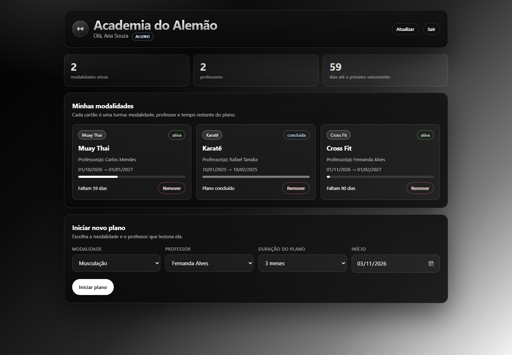
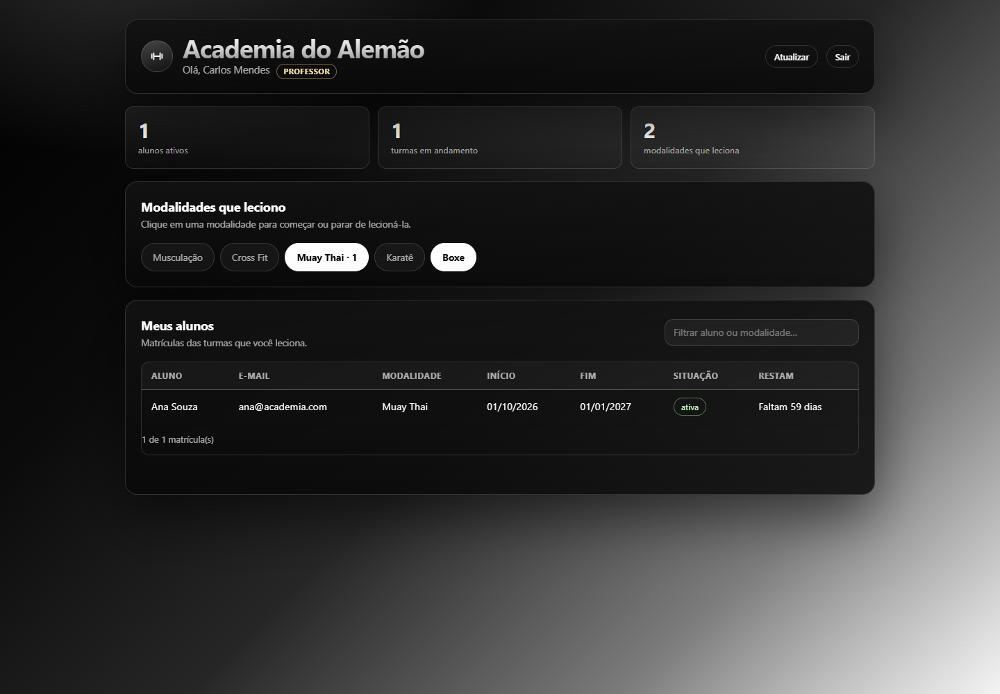
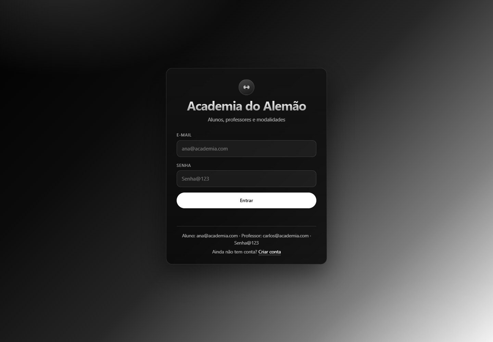
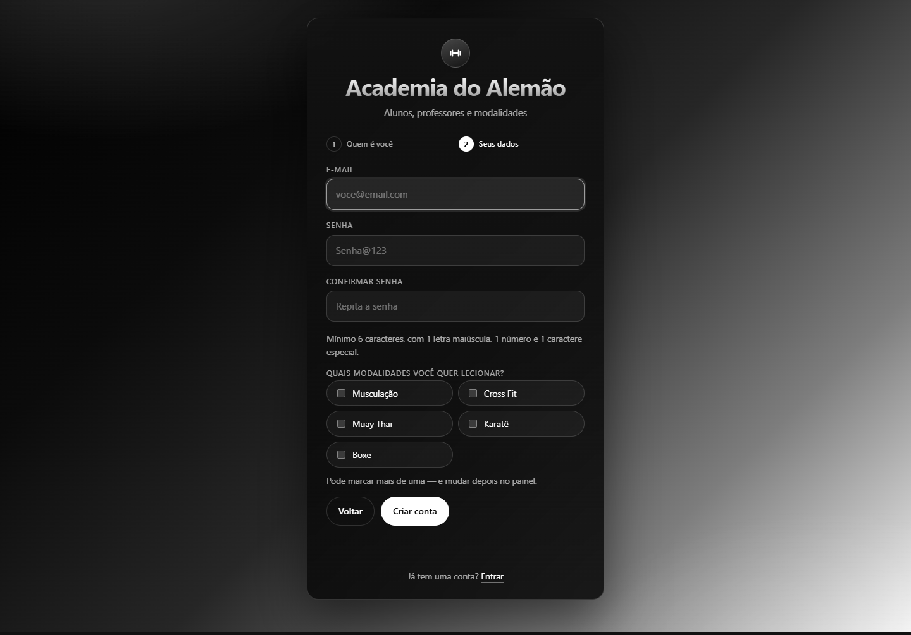
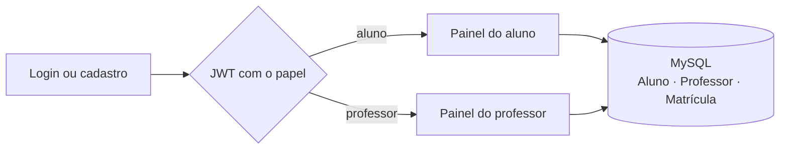

<p align="center">
  
</p>

<p align="center">
  
  
  
  
  
  
</p>

<p align="center">
  Sistema de academia com <strong>duas APIs independentes</strong>, o mesmo frontend e um banco MySQL
  de três tabelas. Aluno e professor entram pelo mesmo login, e o painel que abre depende do
  papel que vem no token.
</p>

## Sobre

O projeto nasceu como trabalho de faculdade e foi implementado duas vezes, com as mesmas regras
e as mesmas telas: uma API em **Node.js/Express** e outra em **Flask**. A antiga tabela `Plano`
deu lugar a `Professor`, então o modelo ficou com três tabelas relacionadas:

```
Professor 1 ─── N Matrícula N ─── 1 Aluno
```

Cada matrícula guarda a **modalidade**, o **professor responsável**, o período e a duração do
plano. As modalidades são fixas: **Musculação, Cross Fit, Muay Thai, Karatê e Boxe**.

## Telas

| Painel do aluno | Painel do professor |
| :---: | :---: |
|  |  |
| Modalidades, professor e dias restantes | Modalidades que leciona e seus alunos |

| Login | Cadastro em duas etapas |
| :---: | :---: |
|  |  |
| Um formulário para os dois papéis | Dados e modalidades do professor |

## Como funciona



- **Aluno:** vê cada modalidade em um cartão com professor, período, barra de progresso e
  quantos dias faltam. Pode remover uma turma ou iniciar um novo plano escolhendo modalidade,
  professor e duração (1, 3, 6 ou 12 meses).
- **Professor:** entra e sai de modalidades com um clique e acompanha os alunos das próprias
  turmas em uma tabela com filtro.
- **Regras:** e-mail único entre os dois papéis, uma matrícula ativa por modalidade, o professor
  precisa lecionar a modalidade da turma e ninguém é excluído com matrícula vinculada.

## Tecnologias

| Camada | Node | Flask |
| --- | --- | --- |
| Servidor | Express | Flask + Flask-CORS |
| Banco | MySQL (`mysql2`) | MySQL (`mysql-connector-python`) |
| Autenticação | JWT + bcrypt | JWT + bcrypt |
| Frontend | HTML, CSS e JavaScript puro | idêntico, em `static/` |

## Rodando o projeto

### 1. Banco de dados

No MySQL Workbench (usuário `root`, sem senha), abra e execute o script
[`docs/Banco.sql`](Academia.node/docs/Banco.sql) inteiro. Ele **recria** o schema `academia_db`
com as três tabelas e os dados de exemplo.

> Se o seu MySQL usa senha ou outra porta, ajuste a conexão em `Academia.node/Server.js` ou
> `Academia.flask/server.py`, ou use as variáveis `DB_HOST`, `DB_PORT`, `DB_USER`,
> `DB_PASSWORD` e `DB_NAME`.

### 2. API em Node.js

```bash
cd Academia.node
npm install
npm start
```

Acesse **http://localhost:8080/Login.html**.

### 3. API em Flask

```bash
cd Academia.flask
pip install -r requirements.txt
python app.py
```

Acesse **http://localhost:8081/Login.html**.

As duas APIs compartilham o mesmo banco e podem rodar ao mesmo tempo, cada uma na sua porta.

## Contas de teste

| Papel | E-mail | Senha |
| --- | --- | --- |
| Aluna | `ana@academia.com` | `Senha@123` |
| Professor | `carlos@academia.com` | `Senha@123` |

O seed também cria Bruno Lima (aluno) e as professoras Fernanda Alves e Rafael Tanaka.

## Testes

A suíte [`_tests/test_academia_v2.mjs`](_tests/test_academia_v2.mjs) cobre login, cadastro em
duas etapas, permissões por papel, regras de matrícula e as rotas usadas pelo frontend:
**88 verificações por API**.

```bash
node _tests/test_academia_v2.mjs http://127.0.0.1:8080   # Node
node _tests/test_academia_v2.mjs http://127.0.0.1:8081   # Flask
```

## Estrutura

```
.
├── Academia.node/     API Express (porta 8080)
│   ├── api/           rotas, middlewares, controllers, services, DAO e models
│   ├── docs/          Banco.sql
│   └── static/        telas, CSS e ApiService
├── Academia.flask/    API Flask (porta 8081), espelhando as mesmas camadas
├── _tests/            suíte HTTP que roda contra qualquer uma das APIs
└── docs/              banner e capturas usadas neste README
```

## Documentação

- [API em Node.js](Academia.node/README.md): passo a passo, endpoints e solução de problemas
- [API em Flask](Academia.flask/README.md): o mesmo roteiro para a versão em Python
