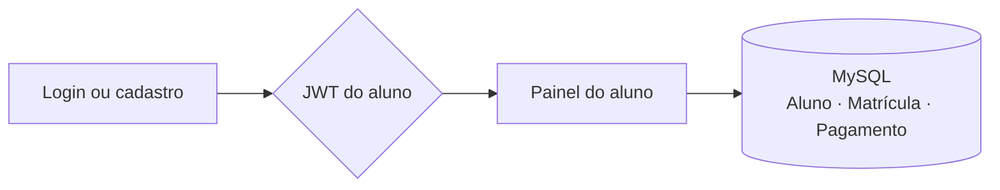

<p align="center">
  
</p>

<p align="center">
  
  
  
  
  
  
</p>

<p align="center">
  Sistema de academia com <strong>duas APIs independentes</strong>, o mesmo frontend e um banco MySQL
  de três tabelas. O aluno entra, escolhe a modalidade e acompanha as mensalidades do plano.
</p>

## Sobre

O projeto nasceu como trabalho de faculdade e foi implementado duas vezes, com as mesmas regras
e as mesmas telas: uma API em **Node.js/Express** e outra em **Flask**. O modelo tem três tabelas
relacionadas — **Aluno**, **Matrícula** e **Pagamento**:

```
Aluno 1 ─── N Matrícula 1 ─── N Pagamento
```

Cada matrícula guarda a **modalidade**, o período e a duração do plano; cada pagamento é uma
**mensalidade** daquela matrícula. As modalidades são fixas: **Musculação, Cross Fit, Muay Thai,
Karatê e Boxe**.

## Telas

| Painel do aluno | Minhas mensalidades |
| :---: | :---: |
|  |  |
| Modalidades, dias restantes e situação | Tabela de mensalidades e formulário de registro |

| Login | Cadastro |
| :---: | :---: |
|  |  |
| Um formulário só, com link para o cadastro | Nome, e-mail e senha em uma única etapa |

## Como funciona



- **Minhas modalidades:** cada plano em um cartão com modalidade, período, barra de progresso,
  quantos dias faltam e quantas mensalidades existem nele.
- **Iniciar novo plano:** modalidade → duração (1, 3, 6 ou 12 meses) → data de início.
- **Minhas mensalidades:** tabela com vencimento, valor, forma de pagamento, status e data de
  pagamento. O aluno registra novas mensalidades, marca como pagas e exclui as que lançou errado.
- **Regras:** e-mail único, uma matrícula ativa por modalidade, e cada aluno só enxerga e altera
  as próprias matrículas e mensalidades (o dono vem do token, não do corpo da requisição).

## Tecnologias

| Camada | Node | Flask |
| --- | --- | --- |
| Servidor | Express | Flask + Flask-CORS |
| Banco | MySQL (`mysql2`) | MySQL (`mysql-connector-python`) |
| Autenticação | JWT + bcrypt | JWT + bcrypt |
| Frontend | HTML, CSS e JavaScript puro | idêntico, em `static/` |

## Rodando o projeto

### 1. Banco de dados

No MySQL Workbench (usuário `root`, sem senha), abra e execute o script
[`docs/Banco.sql`](Academia.node/docs/Banco.sql) inteiro. Ele **recria** o schema `academia_db`
com as três tabelas e os dados de exemplo.

> Se o seu MySQL usa senha ou outra porta, ajuste a conexão em `Academia.node/Server.js` ou
> `Academia.flask/server.py`, ou use as variáveis `DB_HOST`, `DB_PORT`, `DB_USER`,
> `DB_PASSWORD` e `DB_NAME`.

### 2. API em Node.js

```bash
cd Academia.node
npm install
npm start
```

Acesse **http://localhost:8080/Login.html**.

### 3. API em Flask

```bash
cd Academia.flask
pip install -r requirements.txt
python app.py
```

Acesse **http://localhost:8081/Login.html**.

As duas APIs compartilham o mesmo banco e podem rodar ao mesmo tempo, cada uma na sua porta.

## Contas de teste

| Aluno | E-mail | Senha |
| --- | --- | --- |
| Ana Souza | `ana@academia.com` | `Senha@123` |
| Bruno Lima | `bruno@academia.com` | `Senha@123` |

O seed traz a Ana com 3 matrículas (2 ativas e 1 concluída) e 5 mensalidades, e o Bruno com
1 matrícula e 2 mensalidades.

## Testes

A suíte [`_tests/test_academia.mjs`](_tests/test_academia.mjs) cobre o frontend servido, as rotas
públicas, o login e o cadastro, as regras de matrícula, o CRUD de pagamentos com as permissões por
dono e o `ON DELETE CASCADE` entre matrícula e mensalidades:
**92 verificações por API**.

```bash
node _tests/test_academia.mjs http://127.0.0.1:8080   # Node
node _tests/test_academia.mjs http://127.0.0.1:8081   # Flask
```

O teste cria dados temporários e **apaga tudo no final**, então o banco volta ao seed.

## Estrutura

```
.
├── Academia.node/     API Express (porta 8080)
│   ├── api/           rotas, middlewares, controllers, services, DAO e models
│   ├── docs/          Banco.sql
│   └── static/        telas, CSS e ApiService
├── Academia.flask/    API Flask (porta 8081), espelhando as mesmas camadas
├── _tests/            suíte HTTP que roda contra qualquer uma das APIs
└── docs/              banner e capturas usadas neste README
```

## Documentação

- [API em Node.js](Academia.node/README.md): passo a passo, endpoints e solução de problemas
- [API em Flask](Academia.flask/README.md): o mesmo roteiro para a versão em Python
