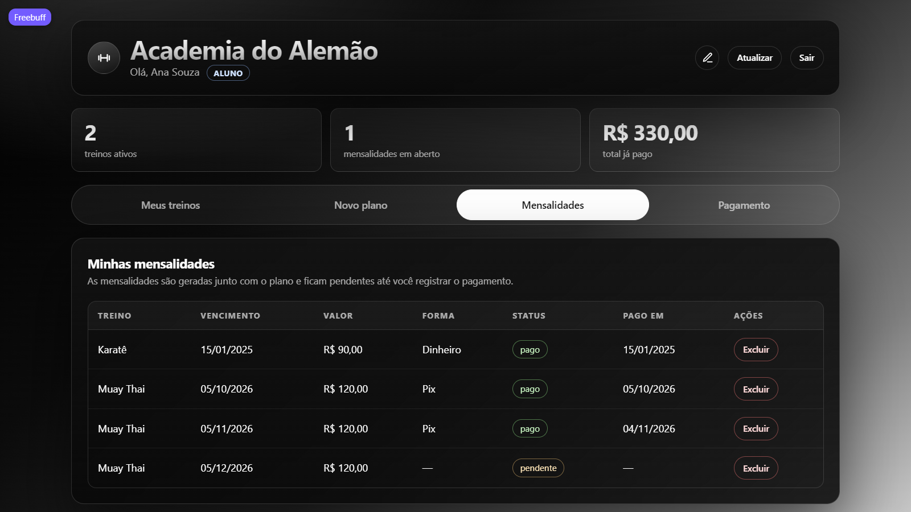
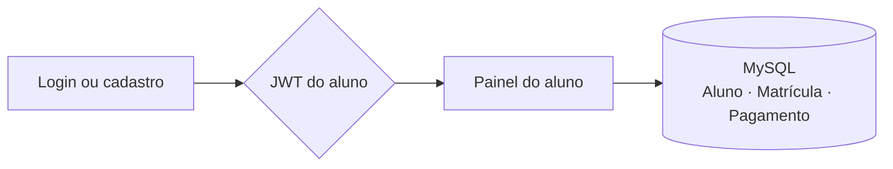

<p align="center">
  
</p>

<p align="center">
  
  
  
  
  
  
</p>

<p align="center">
  Sistema de academia com <strong>duas APIs independentes</strong>, o mesmo frontend e um banco MySQL
  de três tabelas. O aluno entra, escolhe o treino e acompanha as mensalidades que o sistema gera
  para o plano.
</p>

## Sobre

O projeto nasceu como trabalho de faculdade e foi implementado duas vezes, com as mesmas regras
e as mesmas telas: uma API em **Node.js/Express** e outra em **Flask**. O modelo tem três tabelas
relacionadas — **Aluno**, **Matrícula** e **Pagamento**:

```
Aluno 1 ─── N Matrícula 1 ─── N Pagamento
```

Cada matrícula guarda o **treino** (a coluna chama-se `treino` no banco) e o período do plano; cada
pagamento é uma **mensalidade** daquela matrícula, com valor fixo por treino. As opções são fixas:
**Musculação** e **Cross Fit** (R$ 60) e **Muay Thai**, **Karatê** e **Boxe** (R$ 120).

## Telas

| Painel do aluno | Minhas mensalidades |
| :---: | :---: |
|  |  |
| Abas do painel com os treinos | Aba de mensalidades com a tabela |

| Login | Cadastro |
| :---: | :---: |
|  |  |
| Um formulário só, com link para o cadastro | Nome, e-mail e senha em uma única etapa |

## Como funciona



- **Abas:** o painel é dividido em **Meus treinos**, **Novo plano**, **Mensalidades** e **Pagamento**,
  e só a aba escolhida aparece na tela — sem rolar a página inteira para achar cada parte.
- **Meus treinos:** cada plano em um cartão com o treino, o período, barra de progresso,
  quantos dias faltam e quantas mensalidades existem nele.
- **Iniciar novo plano:** o aluno informa o treino e o período, e a API já cria uma mensalidade
  pendente por mês, do início até o último vencimento que não ultrapasse a data final.
- **Minhas mensalidades:** tabela com treino, vencimento, valor, forma de pagamento, status e data
  de pagamento. O valor vem do treino (R$ 60 ou R$ 120) e é calculado no servidor. O aluno registra
  o pagamento informando a forma usada e pode excluir uma mensalidade lançada errado.
- **Meus dados:** o aluno troca e-mail e, se quiser, a senha — confirmando com a senha atual.
- **Regras:** e-mail único, uma matrícula ativa por treino, e cada aluno só enxerga e altera
  as próprias matrículas e mensalidades (o dono vem do token, não do corpo da requisição).

## Tecnologias

| Camada | Node | Flask |
| --- | --- | --- |
| Servidor | Express | Flask + Flask-CORS |
| Banco | MySQL (`mysql2`) | MySQL (`mysql-connector-python`) |
| Autenticação | JWT + bcrypt | JWT + bcrypt |
| Frontend | HTML, CSS e JavaScript puro | idêntico, em `static/` |

## Rodando o projeto

### 1. Banco de dados

No MySQL Workbench (usuário `root`, sem senha), abra e execute o script
[`docs/Banco.sql`](Academia.node/docs/Banco.sql) inteiro. Ele cria o schema `academia_db` e as
três tabelas sem apagar tabelas ou dados existentes. Os dados de exemplo devem ser inseridos
apenas uma vez, em um banco novo ou vazio; executar novamente pode gerar erro de chave duplicada.

> Se o seu MySQL usa senha ou outra porta, ajuste a conexão em `Academia.node/Server.js` ou
> `Academia.flask/server.py`, ou use as variáveis `DB_HOST`, `DB_PORT`, `DB_USER`,
> `DB_PASSWORD` e `DB_NAME`.

### 2. API em Node.js

```bash
cd Academia.node
npm install
npm start
```

Acesse **http://localhost:8080/Login.html**.

### 3. API em Flask

```bash
cd Academia.flask
pip install -r requirements.txt
python app.py
```

Acesse **http://localhost:8081/Login.html**.

As duas APIs compartilham o mesmo banco e podem rodar ao mesmo tempo, cada uma na sua porta.

## Contas de teste

| Aluno | E-mail | Senha |
| --- | --- | --- |
| Ana Souza | `ana@academia.com` | `Senha@123` |
| Bruno Lima | `bruno@academia.com` | `Senha@123` |

O seed traz a Ana com 3 matrículas (2 ativas e 1 concluída) e 9 mensalidades, e o Bruno com
1 matrícula e 4 mensalidades.

## Testes

A suíte [`Academia.flask/tests/test_business_rules.py`](Academia.flask/tests/test_business_rules.py)
usa `unittest` com DAOs falsos, então roda **sem banco e sem servidor**: são **21 testes** cobrindo
os preços por treino, os vencimentos mensais, a geração das mensalidades dentro de uma transação, a
limpeza da forma de pagamento ao voltar para pendente, as permissões por dono e a troca de e-mail e
senha do perfil.

```bash
cd Academia.flask
python -m unittest discover -s tests -t .
```

## Estrutura

```
.
├── Academia.node/     API Express (porta 8080)
│   ├── api/           rotas, middlewares, controllers, services, DAO e models
│   ├── docs/          Banco.sql
│   └── static/        telas, CSS e ApiService
├── Academia.flask/    API Flask (porta 8081), espelhando as mesmas camadas
│   └── tests/         testes de unidade das regras de negócio
└── docs/              banner e capturas usadas neste README
```

## Documentação

- [API em Node.js](Academia.node/README.md): passo a passo, endpoints e solução de problemas
- [API em Flask](Academia.flask/README.md): o mesmo roteiro para a versão em Python
